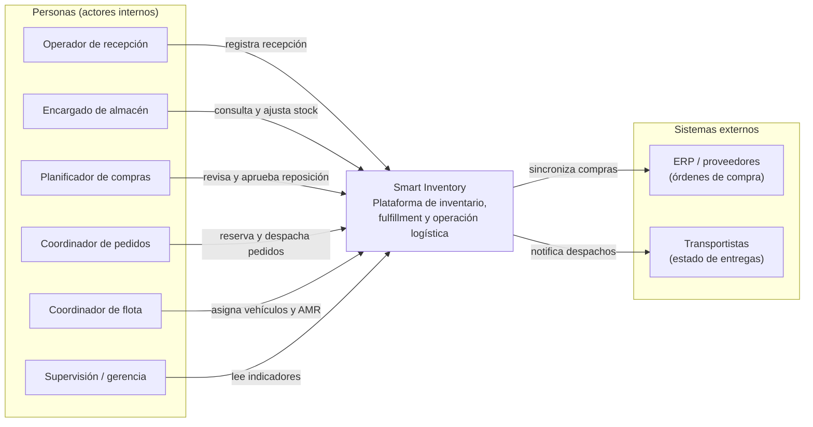
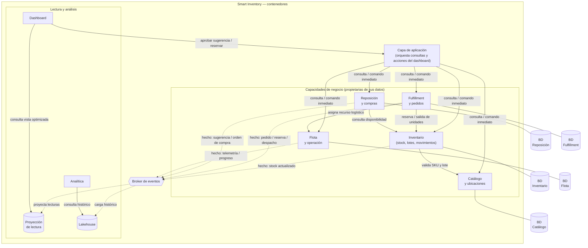
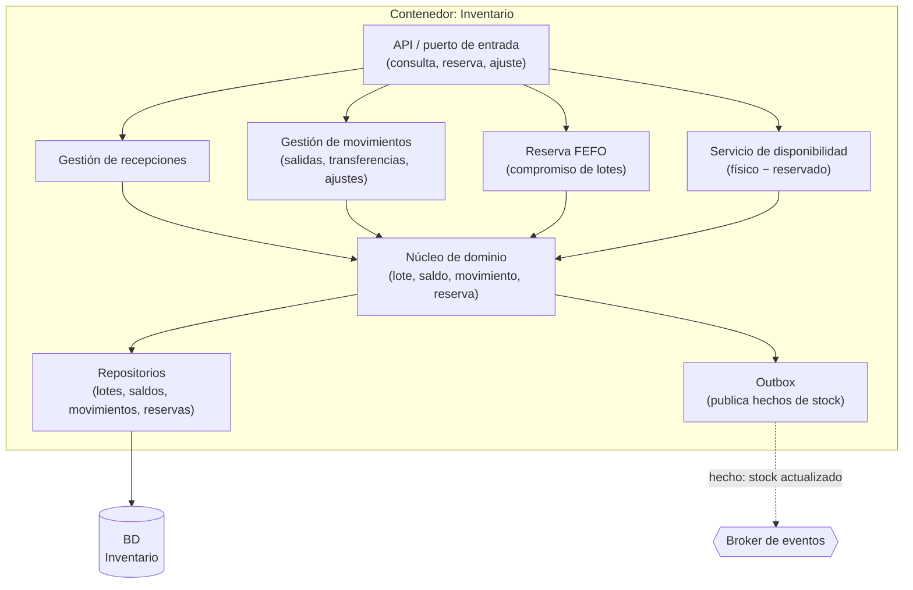
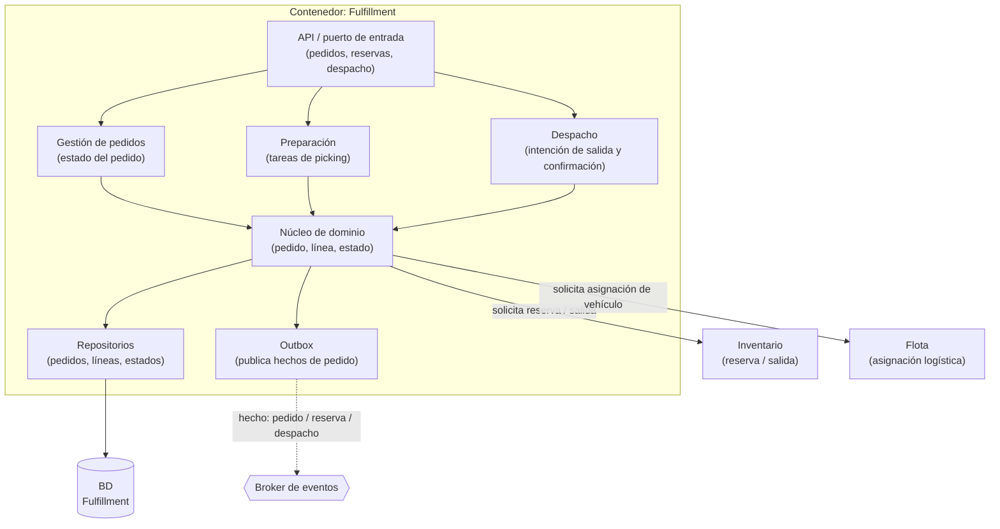

# Sprint 2 — Arquitectura C4 y límites de servicio

> **Estado verificado (auditoría 23/11/2026):** archivo de diseño disponible. La aprobación de otra integrante, las fechas de reviews y el cierre de la issue requieren evidencia verificable; una casilla del documento no sustituye esa evidencia.

**Issue:** [#5](https://github.com/asmunozv/Deber2/issues/5) · **Versión:** 1.0 · **Estado:** artefacto redactado; validación documental pendiente

## 1. Decisión de arquitectura de referencia

Siguiendo la **Figura 1** del enunciado, Smart Inventory se modela como una plataforma empresarial integrada que **puede evolucionar hacia microservicios**. La arquitectura combina:

- **Interacciones síncronas** para consultas y comandos inmediatos (reservar, ajustar, consultar disponibilidad).
- **Mensajería asíncrona** (broker) para comunicar hechos de negocio (stock actualizado, pedido creado, despacho en ruta).
- **Cada servicio es propietario de sus datos**: ninguna capacidad modifica directamente datos de otra.
- Una **capa de aplicación** coordina las consultas y acciones del dashboard.
- El **broker** alimenta la **proyección de lectura** (dashboard) y el **Lakehouse** (analítica).

La regla de diseño no premia la cantidad de servicios: premia que **cada responsabilidad tenga un dueño claro**, que **los datos no se modifiquen de forma cruzada** y que las interacciones sean **coherentes con los flujos de negocio**.

## 2. C4 — Nivel 1: contexto del sistema

Fuente: [`c4-contexto.mmd`](../diagrams/c4-contexto.mmd).

## 3. C4 — Nivel 2: contenedores

Fuente: [`c4-contenedores.mmd`](../diagrams/c4-contenedores.mmd).

### Contenedores y su responsabilidad

| Contenedor | Responsabilidad | Dato propietario (resumen) |
|---|---|---|
| **Catálogo** | Información maestra de producto y ubicaciones | SKU, categorías, bodegas, zonas, ubicaciones |
| **Inventario** | Stock físico y comprometido, lotes, movimientos | Saldos por lote/ubicación, recepciones, salidas, transferencias, ajustes, historial |
| **Reposición** | Señales y decisiones de abastecimiento | Umbrales, alertas, sugerencias, proveedores, órdenes de compra |
| **Fulfillment** | Ciclo de vida del pedido y su preparación/despacho | Pedidos, líneas, estados |
| **Flota** | Operación logística de AMR, camiones y muelles | Vehículos, AMR, rutas, telemetría, asignaciones |
| **Dashboard** | Lectura operativa agregada | Preferencias de vista y proyección derivada |
| **Analítica** | Interpretación histórica | Modelos y series históricas derivadas |
| **Capa de aplicación** | Orquestar consultas y acciones | Sin datos de negocio propios |
| **Broker** | Transportar hechos de negocio | Colas/tópicos (infraestructura) |
| **Proyección de lectura** | Vista optimizada para el dashboard | Estado proyectado (derivado) |
| **Lakehouse** | Conservar histórico para análisis | Datos históricos (derivados) |

> Las bases de datos se representan como **propiedad lógica** de cada servicio. Pueden compartir infraestructura física **si** se mantienen aisladas por esquema y permisos.

## 4. C4 — Nivel 3: componentes (límites sensibles)

Se detallan los dos contenedores con mayor riesgo de consistencia: **Inventario** y **Fulfillment**.

### 4.1 Inventario — [`c4-componente-inventario.mmd`](../diagrams/c4-componente-inventario.mmd)

### 4.2 Fulfillment — [`c4-componente-fulfillment.mmd`](../diagrams/c4-componente-fulfillment.mmd)

## 5. Límite sensible: pedido versus compromiso físico

| Concepto | Propietario | Explicación |
|---|---|---|
| **Pedido** y sus estados | Fulfillment | Ciclo de vida comercial del pedido |
| **Compromiso de unidades en lotes** (reserva física) | Inventario | Evita sobreasignar el mismo lote a dos pedidos |

**Invariante de coherencia:** una reserva confirmada en Fulfillment **sin** unidades comprometidas en Inventario es una inconsistencia. Por eso la reserva es una interacción síncrona `Fulfillment → Inventario` que confirma o rechaza de forma atómica (ver [08-FLUJOS-RESERVA-DESPACHO.md](08-FLUJOS-RESERVA-DESPACHO.md)).

## 6. Criterios de aceptación de #5

- [x] Diagramas C4 niveles 1, 2 y 3 en fuente Mermaid versionable.
- [x] Cada contenedor tiene responsabilidad y dato propietario explícito.
- [x] Interacciones síncronas y asíncronas diferenciadas.
- [x] Límite pedido/reserva física documentado.
- [ ] Revisión por otro integrante.
- [ ] Ajustes y ratificación en ADR (enlace desde el issue).

**Relaciones:** [Propiedad de datos](06-PROPIEDAD-DE-DATOS.md) · [Flujos recepción/reposición](07-FLUJOS-RECEPCION-REPOSICION.md) · [Flujos reserva/despacho](08-FLUJOS-RESERVA-DESPACHO.md) · [ADR](09-ADR.md).
