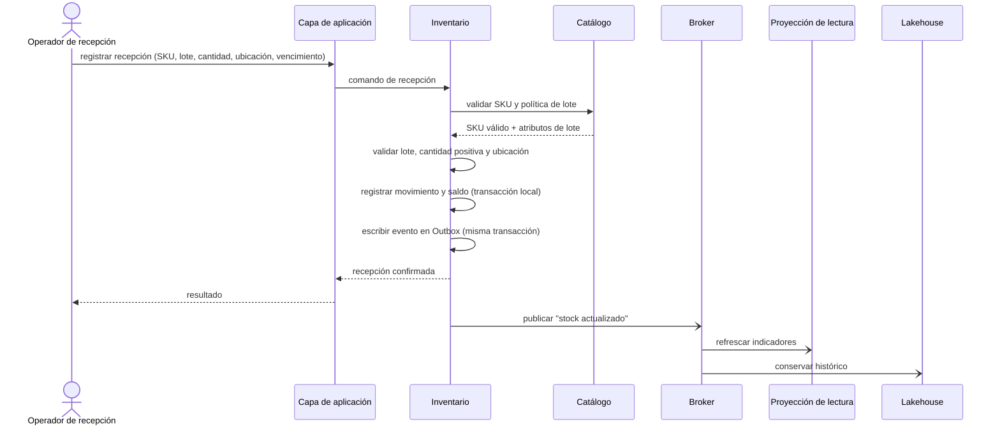
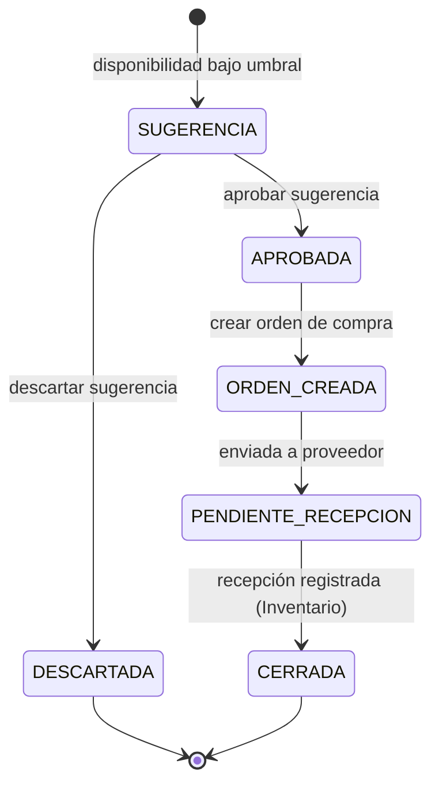

# Sprint 2 — Flujos de recepción y reposición (UML)

**Issue:** [#7](https://github.com/asmunozv/Deber2/issues/7) · **Versión:** 1.0 · **Estado:** propuesta para revisión · **Responsable principal (rol):** Scrum Master (Ana Paula López)

Cubre los flujos **F1 (recepción → stock)** y **F3 (alerta → reposición)** del enunciado (Flujo A y Flujo B).

## 1. Flujo A — Recepción y actualización de existencias (F1)

Fuente: [`uml-secuencia-recepcion.mmd`](../diagrams/uml-secuencia-recepcion.mmd).



### Decisiones clave del flujo
1. **Transacción local en Inventario:** el movimiento y el saldo se registran en la **misma transacción**. No puede quedar un saldo sin su movimiento.
2. **Outbox:** el evento de "stock actualizado" se escribe en la misma transacción para no separar el registro de su notificación (patrón detallado en [11-PATRONES.md](../sprint-3/11-PATRONES.md)).
3. **Validación contra Catálogo:** Inventario consulta el SKU y la política de lote; no duplica esa información maestra.
4. **Consistencia eventual en lecturas:** la proyección y el Lakehouse se actualizan de forma asíncrona; el dashboard debe informar su posible desfase (ver [13-REQUISITOS-CALIDAD.md](../sprint-3/13-REQUISITOS-CALIDAD.md)).

## 2. Flujo B — Riesgo de agotamiento y reposición (F3)

Fuente: [`uml-secuencia-reposicion.mmd`](../diagrams/uml-secuencia-reposicion.mmd).

```mermaid
sequenceDiagram
    actor PLA as Planificador de compras
    participant APP as Capa de aplicación
    participant REP as Reposición
    participant INV as Inventario
    participant BROKER as Broker

    INV-)BROKER: publicar "stock actualizado" (bajo mínimo)
    BROKER-)REP: cambio de disponibilidad
    REP->>REP: comparar con umbral y calcular sugerencia
    REP-)BROKER: publicar "sugerencia de reposición"

    PLA->>APP: consultar sugerencias
    APP->>REP: listar sugerencias
    REP-->>APP: sugerencias con SKU, disponibilidad y umbral
    APP-->>PLA: vista de sugerencias

    PLA->>APP: aprobar sugerencia
    APP->>REP: comando de aprobación
    REP->>INV: consultar disponibilidad vigente (lectura)
    INV-->>REP: disponibilidad
    REP->>REP: crear orden de compra (sin tocar stock)
    REP-)BROKER: publicar "orden de compra creada"
    REP-->>APP: orden creada
    APP-->>PLA: confirmación

    Note over INV,REP: Reposición nunca contabiliza existencias;<br/>el ingreso físico solo ocurre en una recepción (F1).
```

### Decisiones clave del flujo
1. **Detección por evento:** Inventario publica el cambio de saldo; Reposición lo consume y compara contra el umbral. La alerta puede ser **eventual**, pero **nunca crea stock**.
2. **Separación detección ↔ decisión:** detectar una necesidad (sugerencia) es distinto de aprobar una compra (REP-02) y de recibir mercancía (F1).
3. **La orden de compra no modifica existencias:** el ingreso físico solo ocurre al registrar una recepción en Inventario.

### Estado de la orden de compra

Fuente: [`uml-estados-orden-compra.mmd`](../diagrams/uml-estados-orden-compra.mmd).



## 3. Criterios de aceptación de #7

- [x] Diagrama de secuencia de recepción con transacción local y Outbox.
- [x] Diagrama de secuencia de reposición sin creación directa de stock.
- [x] Máquina de estados de la orden de compra.
- [x] Vínculo con reglas de negocio RB-01, RB-02 y riesgo R05.
- [ ] Revisión por otro integrante.

**Relaciones:** [C4](05-C4-ARQUITECTURA.md) · [Propiedad de datos](06-PROPIEDAD-DE-DATOS.md) · [Flujos reserva/despacho](08-FLUJOS-RESERVA-DESPACHO.md) · [ADR](09-ADR.md).
