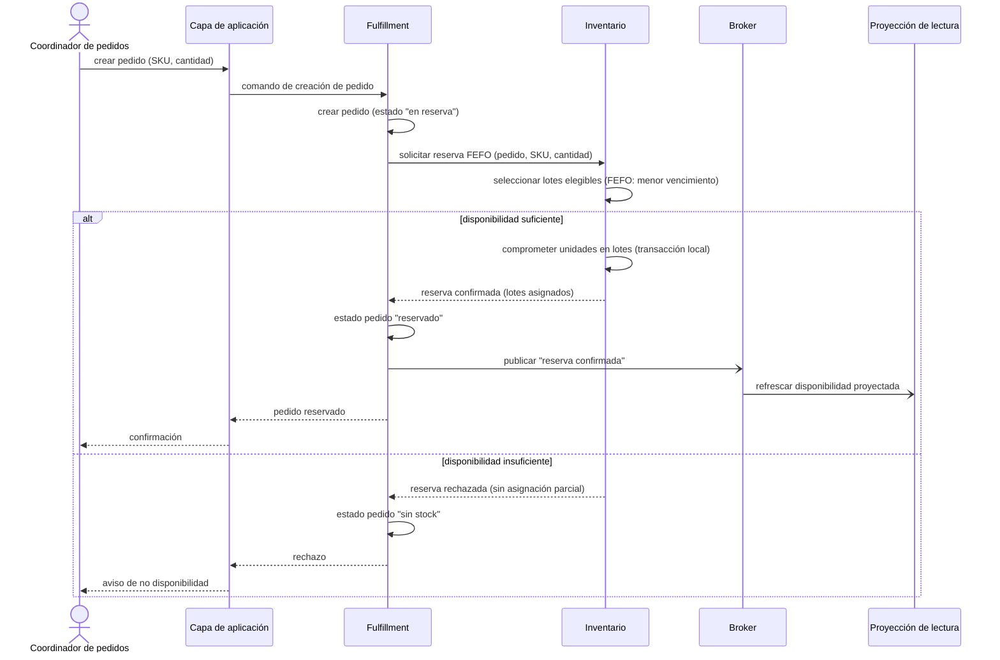
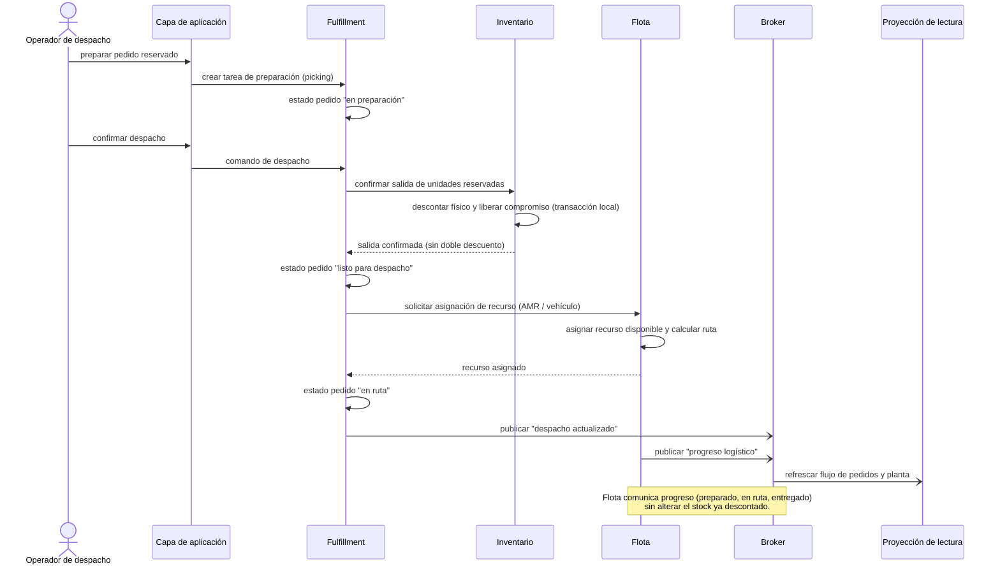
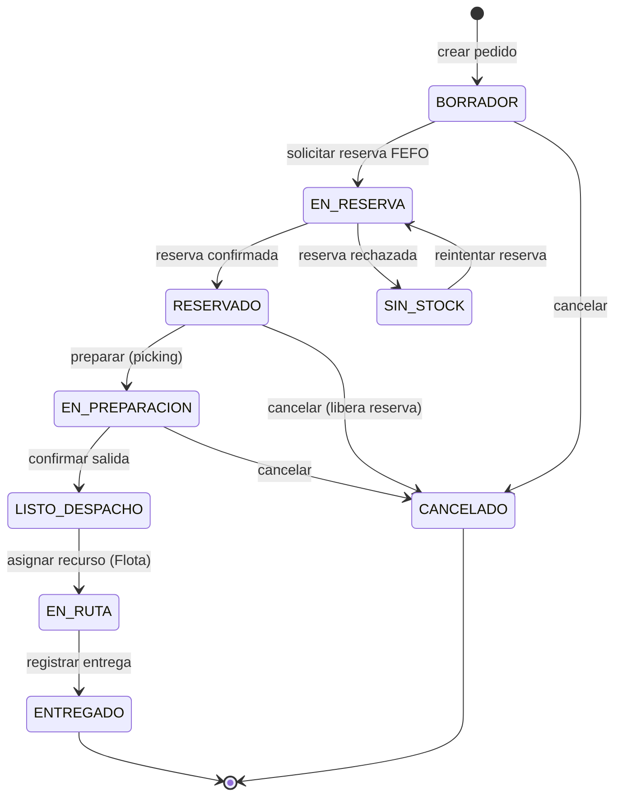
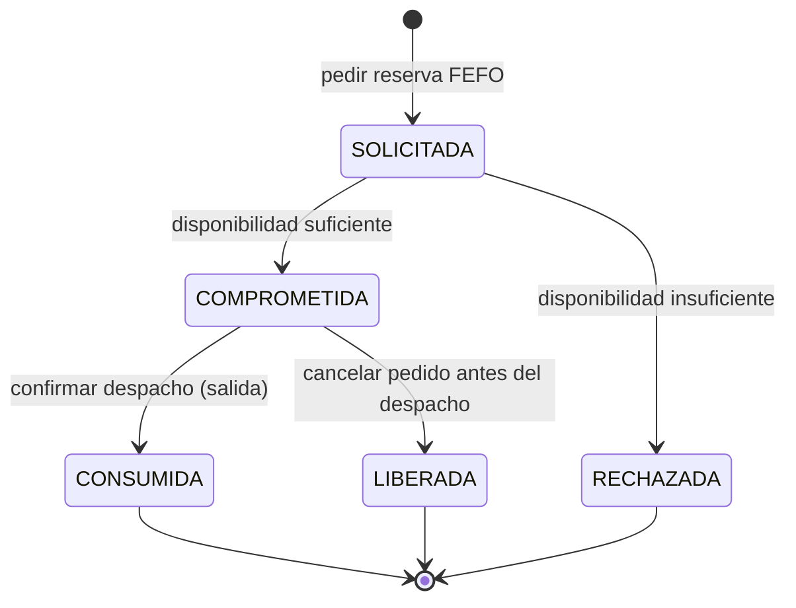

# Sprint 2 — Flujos de reserva FEFO y despacho (UML)

**Issue:** [#8](https://github.com/asmunozv/Deber2/issues/8) · **Versión:** 1.0 · **Estado:** propuesta para revisión · **Responsable principal (rol):** Product Owner (Ariana Muñoz)

Cubre los flujos **F4 (reserva FEFO)** y **F5 (despacho/flota)** del enunciado (Flujo C).

## 1. Flujo C — Reserva con criterio FEFO (F4)

Fuente: [`uml-secuencia-reserva-fefo.mmd`](../diagrams/uml-secuencia-reserva-fefo.mmd).

### Decisiones clave del flujo
1. **FEFO:** Inventario prioriza lotes con vencimiento más próximo que siguen siendo elegibles; ante empate, fecha de recepción más antigua (RB-04).
2. **Sin reserva parcial (MVP):** si la cantidad elegible no alcanza, se **rechaza la reserva completa** (RB-05).
3. **Consistencia fuerte:** la reserva es una interacción **síncrona** que confirma o rechaza de forma atómica. Ante solicitudes concurrentes sobre el mismo lote, Inventario garantiza **una sola decisión consistente** sin exceder el físico (riesgo R01).
4. **Solo lotes elegibles:** no vencidos y no bloqueados (RB-03).

## 2. Flujo C — Despacho y flota (F5)

Fuente: [`uml-secuencia-despacho.mmd`](../diagrams/uml-secuencia-despacho.mmd).

### Decisiones clave del flujo
1. **Sin doble descuento:** confirmar un despacho descuenta unidades **ya reservadas** y libera el compromiso asociado (RB-06). Una confirmación repetida no genera un segundo descuento.
2. **Coordinación sin duplicar datos:** Fulfillment pide la salida a Inventario y la asignación a Flota; no modifica saldos ni telemetría por sí solo.
3. **Cancelación:** una cancelación antes del despacho libera la reserva (RB-07); las devoluciones quedan fuera del MVP.

## 3. Máquinas de estado

### 3.1 Pedido — [`uml-estados-pedido.mmd`](../diagrams/uml-estados-pedido.mmd)

### 3.2 Reserva (compromiso de unidades) — [`uml-estados-reserva.mmd`](../diagrams/uml-estados-reserva.mmd)

## 4. Escenario vertical documentado

`registrar SKU perecible → recibir dos lotes en ubicaciones distintas → consultar stock → detectar umbral → reservar cantidad con FEFO → confirmar despacho → consultar tablero`. El diagrama de actividad integral está en [`uml-actividad-flujo-vertical.mmd`](../diagrams/uml-actividad-flujo-vertical.mmd) y se reutiliza en la presentación (Sprint 4).

## 5. Criterios de aceptación de #8

- [x] Diagrama de secuencia de reserva FEFO con caminos de éxito y rechazo.
- [x] Diagrama de secuencia de despacho sin doble descuento.
- [x] Máquinas de estados de pedido y reserva.
- [x] Vínculo con RB-03..RB-07 y riesgos R01, R02, R03, R08.
- [ ] Revisión por otro integrante.

**Relaciones:** [C4](05-C4-ARQUITECTURA.md) · [Propiedad de datos](06-PROPIEDAD-DE-DATOS.md) · [Flujos recepción/reposición](07-FLUJOS-RECEPCION-REPOSICION.md) · [ADR](09-ADR.md).
