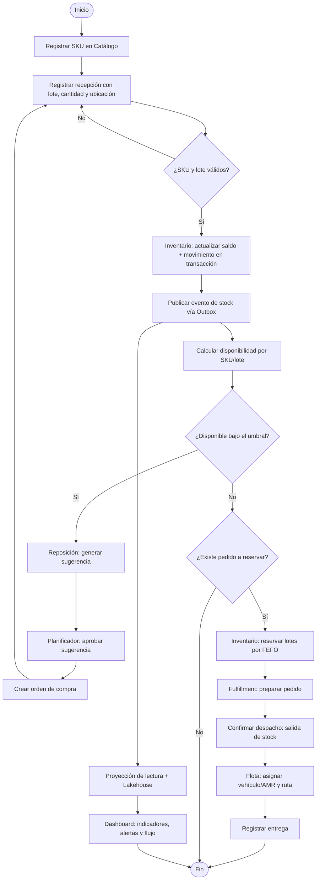

# Sprint 4 — Presentación del flujo vertical

**Issue:** [#18](https://github.com/asmunozv/Deber2/issues/18) · **Versión:** 1.0 · **Estado:** terminado (revisión registrada) · **Responsable principal (rol):** Product Owner (Ariana Muñoz)

## 1. Guion de la presentación

El recorrido narrativo sigue el orden **recepción → actualización de stock → alerta → reposición**, explicando en cada paso **quién es responsable** y **qué interacción** ocurre.

| Paso | Flujo | Responsable | Interacción clave |
|---|---|---|---|
| 1 | Registrar SKU perecible | Catálogo | Maestra de producto |
| 2 | Recibir lote en ubicación | Inventario | Valida SKU (Catálogo) → transacción local + Outbox |
| 3 | Actualizar stock (saldo + movimiento) | Inventario | Publica "stock actualizado" |
| 4 | Detectar umbral | Reposición | Consume evento → sugerencia |
| 5 | Aprobar reposición | Reposición | Crea orden de compra (no crea stock) |
| 6 | Reservar con FEFO | Inventario / Fulfillment | `Fulfillment → Inventario` síncrono |
| 7 | Confirmar despacho | Fulfillment / Inventario | Salida sin doble descuento |
| 8 | Asignar flota | Flota | Recurso + ruta |
| 9 | Consultar tablero | Dashboard | Proyección de lectura |

## 2. Diagrama de apoyo

Fuente: [`uml-actividad-flujo-vertical.mmd`](../diagrams/uml-actividad-flujo-vertical.mmd).

## 3. Autores y contribuciones

| Integrante | Rol | Contribución principal |
|---|---|---|
| Laura Reyes | Líder de arquitectura | C4, propiedad de datos, ADR, patrones y calidad |
| Ana Paula López | Scrum Master / facilitadora | Backlog, flujos de recepción/reposición, matriz e interacciones |
| Ariana Muñoz | Product Owner | Visión, historias, reserva/despacho, dashboard y presentación |

> Nombres y división de trabajo confirmados con el equipo.

## 4. Criterios de aceptación de #18

- [x] Guion de presentación con responsabilidades e interacciones.
- [x] Diagrama de actividad de apoyo.
- [x] Confirmación de autores y contribuciones individuales.
- [ ] Ensayo y ajustes con el equipo.

**Relaciones:** [Dashboard](15-DASHBOARD.md) · [Informe final](19-INFORME-FINAL.md) · [Flujo vertical](../diagrams/uml-actividad-flujo-vertical.mmd).
